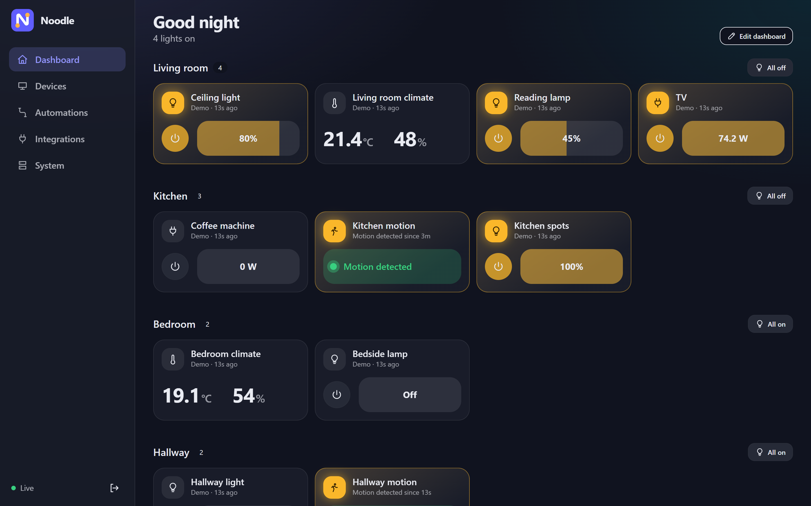
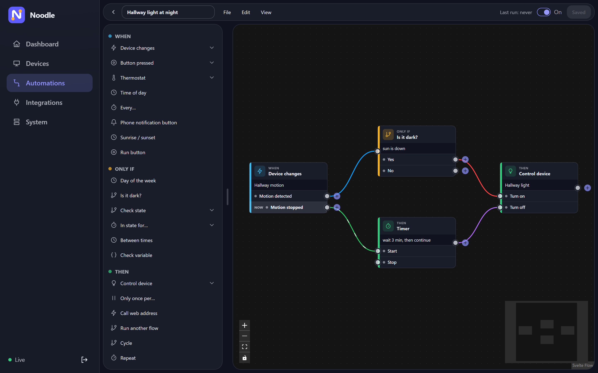

<div align="center">


# Noodle

**A self-hosted smart home hub that runs entirely on your own network.**

[](https://github.com/ThisisDaan/noodle-home/releases)
[](https://github.com/ThisisDaan/noodle-home/actions/workflows/ci.yml)
[](LICENSE)


[Why Noodle](#why-noodle) · [Install](#install) · [Integrations](#integrations) · [Automations](#automations) · [Docs](#documentation) · [Contributing](CONTRIBUTING.md)

<br>



</div>

---

Noodle brings the devices you already own (Zigbee, Matter, Thread, Hue, Bluetooth sensors and a long list of Wi‑Fi gear) into one clean interface. You arrange your own dashboard, group devices into rooms, and build automations with a visual editor.

It is built around three ideas:

- **Local only.** Every integration talks to devices over your LAN, Zigbee, Matter or Bluetooth. No cloud account is needed to run your home.
- **Everything in the app.** Devices, rooms, dashboards and automations are all set up with pickers and drag-and-drop. No config files to edit.
- **Your data stays readable.** Behind the scenes, automations and settings are plain YAML files you can back up, keep in git, or have an AI write for you.

## Why Noodle?

There are two kinds of smart home software out there, and both make you pay a price.

**The vendor apps** are polished, but your home runs on someone else's server. When their cloud goes down, your light switch goes down with it. When they sunset a product, your hardware becomes a paperweight. And every time you walk into the kitchen, a data center somewhere hears about it.

**The power-user hubs** keep everything local, which is great, and then hand you a text editor. Want to rename a light? Open a config file. Want to add a second motion sensor to an automation? Open a config file, find the right block, count your spaces, save, reload, read the error, realise it was a tab, fix it, reload again. Wonderful. Truly the future of home automation. Your partner asked for the hallway light to come on a bit later in the evening, and three hours later you're reading a forum thread from 2019 about indentation.

Noodle takes the good half of each:

| | Vendor apps | Power-user hubs | **Noodle** |
|---|:---:|:---:|:---:|
| Works when the internet is down | ✗ | ✓ | **✓** |
| No account or subscription | ✗ | ✓ | **✓** |
| Mix brands in one place | some | ✓ | **✓** |
| Set everything up in the app | ✓ | partly | **✓** |
| Change an automation without editing a file | ✓ | sometimes | **✓** |
| Automations you can read, version and share | ✗ | ✓ | **✓** |
| AI can write automations for your real devices | ✗ | ✗ | **✓** |
| Runs on a Raspberry Pi | ✗ | ✓ | **✓** |

The YAML files are still there, because they're a great format for storage, backups and AI. You just never *have* to open one. If something in Noodle can only be set up by editing a file, we treat that as a bug.

## Features

- **Dashboard** you arrange yourself, with a card designer for any device (switches, sliders, dials, values, graphs)
- **Visual flow editor** for automations, with timers, conditions, sunrise/sunset, a thermostat node and more
- **AI-assisted automations:** copy a prompt that includes your real devices, paste the answer back, and Noodle validates it before adding it, switched off, for you to review
- **History graphs** for every sensor
- **Rooms and custom devices**, for grouping things or keeping your own values
- **Android app** with notifications and quick controls (see [`noodle-android/`](noodle-android/))
- **Plugins:** add only the integrations you use; each one is a self-contained folder
- **One-click updates** from the System page

## Install

Pick your computer. Each takes about 10 minutes, and most of that is waiting. Noodle needs no account and no cloud.

### Windows

1. **Download Noodle:** [click here for the ZIP](https://github.com/ThisisDaan/noodle-home/archive/refs/heads/main.zip). Right-click the downloaded file and choose **Extract All**.
2. Open the extracted folder, then the **noodle** folder inside it, and **double-click `run.bat`**.
   - If Windows says "Windows protected your PC", click **More info**, then **Run anyway**.
   - If Python or Bun is missing, it asks to install them. Press **Y**. If it then asks you to double-click `run.bat` again, do that.
3. Wait a few minutes the first time. When the window that opened says `Noodle is starting`, open **http://localhost:8090** in your browser. A short setup wizard walks you through the rest. Every step can be skipped.
4. If Windows Firewall asks about Python, choose **Private networks**, so your phone and other devices can open Noodle too.

To start Noodle again later, double-click `run.bat` again. To stop it, close that window. Bluetooth sensors need Bluetooth switched on in Windows.

### macOS

1. Open **Terminal** and install the tools. If you do not have [Homebrew](https://brew.sh), install that first.
   ```bash
   brew install python@3.12 git
   curl -fsSL https://bun.sh/install | bash
   ```
   Close Terminal and open it again.
2. Download and start Noodle:
   ```bash
   git clone https://github.com/ThisisDaan/noodle-home.git
   cd noodle-home/noodle
   ./run.sh
   ```
3. Open **http://localhost:8090** when you see `Noodle is starting`.

For Bluetooth sensors, allow Terminal under System Settings → Privacy & Security → Bluetooth.

### Raspberry Pi, mini PC or Linux server (recommended for always-on)

A small always-on computer is the best home for Noodle, since it keeps running when your PC is off. Install Docker (see [docs.docker.com/engine/install](https://docs.docker.com/engine/install/), or on a Pi `curl -fsSL https://get.docker.com | sh`), then:

```bash
git clone https://github.com/ThisisDaan/noodle-home.git
cd noodle-home/noodle
docker compose up -d
```

Open `http://<your-machine>:8090` from any device on your network. No Docker? `./run.sh` works on Linux too (needs Python 3.11 to 3.13 and Bun).

### Let an AI install it for you

Paste this into ChatGPT, Claude or any AI assistant that can run commands on your computer:

> Install Noodle on my computer by following https://github.com/ThisisDaan/noodle-home/blob/main/docs/INSTALL-AI.md

### Good to know

- **Updating:** with Docker, use **System → Check for updates** in the app. With the run script, run `run.bat --update` (in a terminal) or `./run.sh --update`.
- **Your data** (settings, automations, history) is in the `noodle/data/` folder. Copy it to back up.
- **Stuck?** If it says Python or Bun is missing even after installing, close the window and start it again. Noodle works with Python 3.11, 3.12 or 3.13, not newer. Still stuck? [Open an issue](https://github.com/ThisisDaan/noodle-home/issues).
- **Updating a ZIP install:** `--update` needs Git. Without it, download the ZIP again and copy your old `noodle/data` folder into the new one.

### Advanced: pip


```bash
./noodle/build-wheel.sh               # needs bun and `pip install build`
python3 -m venv /opt/noodle/venv
/opt/noodle/venv/bin/pip install noodle/backend/dist/noodle_home-*.whl
NOODLE_DATA=$HOME/noodle-data /opt/noodle/venv/bin/noodle
```

To run it as a service, copy [`noodle/noodle.service`](noodle/noodle.service) to `/etc/systemd/system/`, adjust the user and paths, and run `sudo systemctl enable --now noodle`. Bluetooth sensors need BlueZ on Linux.

## Integrations

| Category | Supported |
|---|---|
| **Protocols** | Zigbee (via Zigbee2MQTT), Matter and Thread, Bluetooth temperature/humidity sensors, MQTT (Tasmota, ESPHome, Home Assistant discovery) |
| **Lighting** | Philips Hue, IKEA DIRIGERA, LIFX, WLED, Nanoleaf, Philips WiZ, Yeelight, Govee |
| **Plugs and switches** | Shelly, TP-Link Kasa |
| **Media** | Sonos, Yamaha MusicCast, Roku, Google speakers (text to speech) |
| **Network** | Pi-hole, UniFi presence detection |
| **Notifications** | ntfy, Noodle Android app |
| **Bridges** | Home Assistant (bring in the devices it controls) |

Most Wi‑Fi devices are found with a search or added by IP address. Searching only runs while you have the search screen open; Noodle never scans your network in the background.

Missing something? An integration is one folder with two files. See [Writing an integration](docs/integrations.md).

## Automations

Automations (called *flows*) are built in the visual editor: pick a trigger, add conditions and actions, and choose devices from a list.

<p align="center">
  
</p>

Each flow is saved as a small YAML file, so you can also:

- keep your flows in version control,
- share them with someone else,
- or let an AI write one. The **Ask an AI** button copies a prompt with your devices and every available step. Imported flows are checked first and always start switched off.

```yaml
# config/flows/hallway-night-light.yaml (the flow in the screenshot above)
id: hallway-night-light
name: Hallway light at night
enabled: false
nodes:
  motion: {type: trigger.state, device_id: <motion-sensor-id>, outputs: ["occupancy:on", "occupancy:off"]}
  dark:   {type: cond.dark}
  wait:   {type: action.timer, minutes: 3}
  light:  {type: action.device, device_id: <hallway-light-id>, key: light, inputs: ["on", "off"]}
edges:
  - {from: motion, out: "occupancy:on", to: dark}
  - {from: dark, out: "yes", to: light, in: "on"}
  - {from: motion, out: "occupancy:off", to: wait, in: start}
  - {from: wait, to: light, in: "off"}
```

See [docs/configuration.md](docs/configuration.md) for the file layout and [docs/AI.md](docs/AI.md) for AI-written flows.

## Documentation

| | |
|---|---|
| [Configuration](docs/configuration.md) | config files, card designer, custom devices, environment variables |
| [Writing an integration](docs/integrations.md) | plugin structure, flow nodes, device search |
| [Flows and AI](docs/AI.md) | how AIs should write flows |
| [Install with an AI](docs/INSTALL-AI.md) | steps an AI assistant can follow to install Noodle |
| [Changelog](CHANGELOG.md) | what changed in each release |

## Development

```bash
# Backend
cd noodle/backend
pip install -r requirements-dev.txt
pytest
NOODLE_DATA=./dev-data python -m noodle

# Frontend (proxies /api to port 8090)
cd noodle/frontend
bun install
bun run dev
```

The backend is FastAPI (Python), the frontend SvelteKit with Tailwind and daisyUI. Read [CONTRIBUTING.md](CONTRIBUTING.md) before opening a pull request.

## License

Noodle is free software under the [GNU General Public License v3.0 or later](LICENSE). You may use, study, change and share it; modified versions must be shared under the same license.
